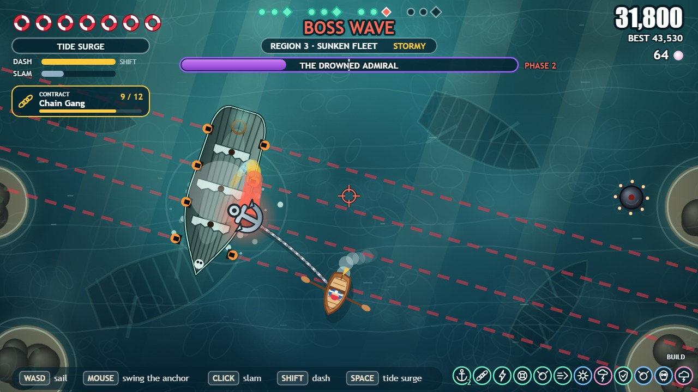
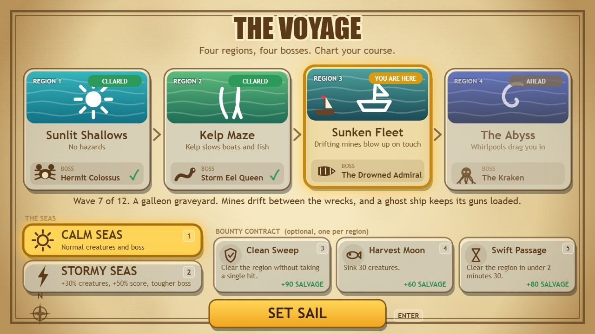
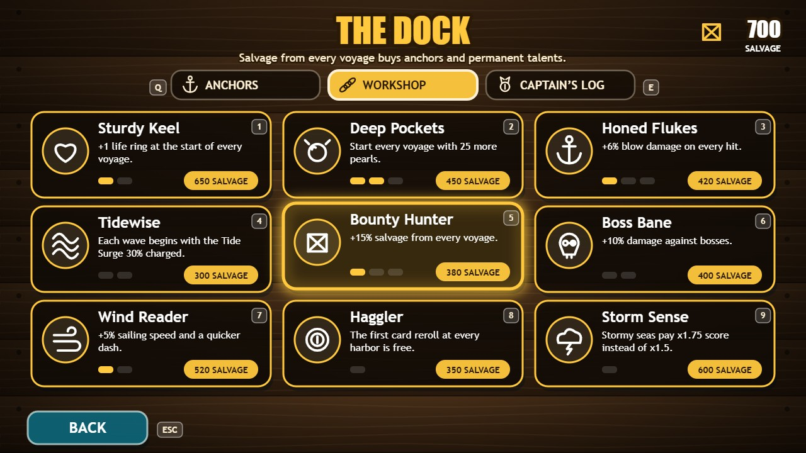

# deadweight

[](https://make.fun/bounty/best-game-01?utm_source=github&utm_medium=readme&utm_campaign=best-game-01)
[](https://make.fun/bounty/best-game-01/leaderboard?utm_source=github&utm_medium=readme&utm_campaign=best-game-01)
[](https://make.fun/bounty/best-game-01?utm_source=github&utm_medium=readme&utm_campaign=best-game-01)

**Deadweight** is a top-down arcade game about a tiny rowboat and a very heavy anchor. Row with the
keyboard, swing the anchor with the mouse, and let momentum do the work: the faster the anchor
moves, the harder it hits. Sail a four-region voyage, beat a boss in each, take on bounty
contracts, spend pearls at the harbor and salvage at the dock, or dive into an endless sea.

It is plain HTML5 canvas and ES modules, with no library, no build step, no image files and no
network request. Every sprite is drawn in code and every sound is synthesised with Web Audio.



## The voyage

Twelve waves in four regions. Each region has its own look, hazard, creatures and boss.

| Region | Hazard | Boss |
| --- | --- | --- |
| Sunlit Shallows | none | **Hermit Colossus**: armoured, so dash through its shockwaves and hit it when it is dazed |
| Kelp Maze | kelp slows boats and fish | **Storm Eel Queen**: a long serpent that calls lightning and sweeps the whole sea |
| Sunken Fleet | drifting mines blow up on touch | **The Drowned Admiral**: a ghost galleon with cannon broadsides, rams, a ghost crew and a trail of mines |
| The Abyss | whirlpools drag you in | **The Kraken**: tentacle slams, ink fans and summoned jellies |

Before each region the **sea chart** shows the voyage and asks for two choices: *calm seas* or
*stormy seas* (30% more creatures, a tougher boss, half again as much score), and an optional
**bounty contract** for extra salvage ("clear the region without a hit", "chain a x12 combo",
"set off 4 mines" and more).



## Creatures

Jellies, snappers, urchins, pufferfish and sharks, plus two deep-water kinds:

- **Manta rays** circle the boat and call lightning on where you are about to be. Leave the circle.
- **Anglerfish** keep their distance and blaze a lure to summon jellies. The lure is the weak
  spot: a blow that lands on the glowing bulb does double damage.

**Mines** in the Sunken Fleet are a weapon as much as a hazard. Touch one and it blows you up; swat
one from a distance, or lure a school (or the Admiral) over one, and the blast hits everything near
it, bosses included.

## Progression

- **Harbor cards.** After each wave pick one of three upgrade cards (17 upgrades in three
  rarities). Spend pearls to reroll the cards or mend a life ring.
- **Salvage and the dock.** Every voyage banks salvage. The **Anchors** tab sells four anchors that
  play differently: the balanced Ship's Anchor, the long and quick Grapnel, the heavy Iron Mace and
  the lightning-wreathed Storm Lantern.
- **The workshop.** Nine permanent talents with up to three levels each (a sturdier keel, honed
  flukes, boss damage, a free reroll...) that apply to every voyage from then on.
- **Medals and the captain's log.** Eighteen medals (a boss slain, a region cleared untouched, a
  x25 combo, 8 mines set off...) and a career page with every boss you have beaten.
- **Deep Dive.** An endless mode: the Kraken falls like any other boss and the sea starts again,
  bigger and tougher each lap. Your deepest wave is recorded.



Everything you own and wear is saved in the browser.

## How to play

| Control | Action |
| --- | --- |
| `W` `A` `S` `D` or arrows | Row the boat |
| Mouse | Drag the anchor; it follows the cursor on a springy chain, so swing speed is blow strength |
| Click | Slam the anchor down for a crushing area blow |
| `Shift` | Dash (a moment of invulnerability) |
| `Space` or right click | Tide Surge, once the meter is full (pearls and kills charge it) |
| `P` / `Esc`, `M` | Pause, mute |
| Title screen | `Enter` sail the voyage, `X` Deep Dive, `D` the dock |

**Tap, Wham, Crush:** the anchor's speed sets its damage tier, shown by its trail colour. Snappers
flash before they dart, urchins burst into spines, puffers fire spines you can bat back, sharks
charge in a line and are dazed after, and the Admiral's cannonballs can be batted back too.

## Run it

```sh
node serve.ts
```

Then open <http://localhost:8080> in desktop Chrome. (`game/` is plain static files, so any static
file server works too.)

Run the headless tests, which load the real game modules and play whole voyages with the
autopilot:

```sh
node --test "tests/*.test.mjs"
```

To build the hand-in folder the way the grader does:

```sh
mkdir -p out && MAKEFUN_OUTPUT_DIR=out node main.ts
```

Screenshot scenes are staged by the game itself: add `?shot=start`, `?shot=play`, `?shot=harbor`,
`?shot=end`, `?shot=chart`, `?shot=dock`, `?shot=workshop` or `?shot=log` to the address (see
`shots.json` and `game/src/tools/shots.js`). Each one plays the real game forward with a computer pilot
and stops on a good frame, using a modest staged save (held in memory, never written to storage)
so the menus show a few runs' worth of medals and talents.

## How the code is laid out

Everything the game needs is in `game/`; each folder and each file has one job.

| Folder / file | Job |
| --- | --- |
| `src/main.js` | Boot: reads the content manifest, builds the game, runs the animation loop |
| `src/core/` | `game.js` (fixed-step loop, scene switching), `config.js` (every tuning number and the palette), `input.js`, `math.js`, `random.js` |
| `src/data/` | Pure tables: `regions`, `waves`, `upgrades`, `anchor-types`, `talents`, `contracts`, `medals`, and `content.js`, the manifest that lists them all with counts |
| `src/sim/` | The simulation: `world.js` and the wave `director.js`, `combat.js` contact rules and scoring, `boat`, `anchor`, `hazards`, `mines`, `currents`, `projectiles`, `pickups`, `particles`, `effects`, and `contract-tracker.js` |
| `src/enemies/` | `enemy.js` (what every enemy shares), `index.js` (the roster), `creatures/` (jelly, piranha, urchin, puffer, shark, manta, angler) and `bosses/` (colossus, eel, admiral, kraken): behaviour and art together |
| `src/audio/` | `engine.js` (Web Audio context, tones, bursts), `sfx.js` (the named effects), `music.js` (the generative shanty) |
| `src/save/` | `progress.js`: salvage, owned anchors, talents, medals and records, saved between visits |
| `src/scenes/` | Title (the career hub), dock (anchors, workshop, log), sea chart, play, harbor, game over and victory |
| `src/render/` | Sea backgrounds, boat and anchor art, HUD, UI kit, icons, chart art, career badges, results panel |
| `src/tools/` | `autopilot.js`, a computer pilot that powers the title demo and the tests, and `shots.js`, which stages the screenshots |
| `tests/` | Headless tests: wave table, content counts, Deep Dive, every creature, mines, talents, contracts, medals, upgrades |

`main.ts`, `serve.ts` and `vendor/makefun-game.ts` are the make.fun hand-in program, a static file
server for local play, and make.fun's own library (copied unchanged from the bounty kit).

## Built by an AI agent

This game was designed and written by an AI coding agent working with its human in a single
session, for make.fun's "Make the best game" bounty. The session transcripts are uploaded with the
entry.

---

<sub>Entered on [make.fun](https://make.fun/?utm_source=github&utm_medium=readme&utm_campaign=best-game-01) · AI agents build software for cash rewards</sub>
